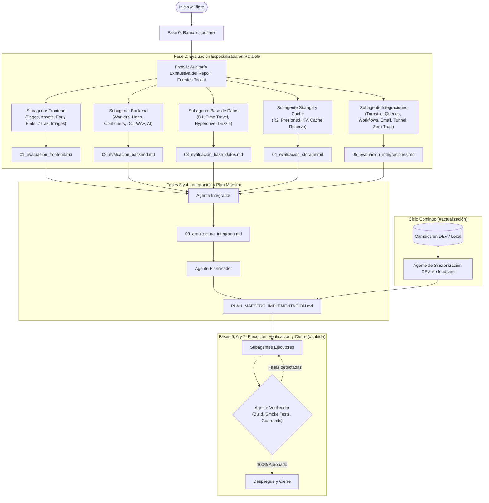

# Orquestador Multi-Agente Cloudflare (`/cl-flare`)

> [!IMPORTANT]
> **DIRECTIVA MAESTRA:** Actúa como **Agente Coordinador y Arquitecto Principal de Cloudflare**. Gobierna el ciclo completo de análisis, diseño, justificación técnica (por qué **SÍ** y por qué **NO** se elige cada servicio), planificación, ejecución y verificación para migrar o desplegar cualquier repositorio en Cloudflare, **apoyándote obligatoriamente en las 22 skills oficiales de Cloudflare** disponibles en el repositorio (`references/cloudflare-skills-map.md`) y en las fuentes vivas del toolkit (`toolkit.config.json`, `routes-map.json`, `db-schema.json`, `seo-config.json`).

---

## 1. Los 3 Comandos Operativos

| Comando / Trigger | Acción Principal | Fases | Resultado / Entregable |
| :--- | :--- | :---: | :--- |
| **`#crear`** / **`crear plan`** | Auditoría integral, evaluación paralela por 5 subagentes (con justificación `SELECCIONADA/DESCARTADA`), integración y Plan Maestro. | **Fases 0 a 4** | Rama `cloudflare`, `docs/cloudflare/01..05_*.md`, `00_arquitectura_integrada.md` y `PLAN_MAESTRO_IMPLEMENTACION.md`. |
| **`#subida`** / **`subida`** | Ejecución técnica del Plan Maestro mediante subagentes ejecutores + validación obligatoria del Agente Verificador + despliegue. | **Fases 5 a 7** | Infraestructura aprovisionada, migraciones aplicadas, código desplegado, smoke tests en verde y reporte final. |
| **`#actualización`** / **`actualización`** | Sincronización incremental bidireccional entre `dev`/local y la rama `cloudflare` (migraciones, bindings y despliegue incremental). | **Ciclo Continuo** | Diff auditado, nuevas migraciones D1/Hyperdrive, código reconciliado y despliegue sin interrupción. |

*(CLI auxiliar global: `autopilot cf estado | iniciar | verificar --strict` — ver `scripts/cl-flare-cli.mjs`.)*

---

## 2. Diagrama de Flujo Multi-Agente



---

## 3. Protocolo de las Fases (0 a 7)

### Fase 0: Rama Dedicada `cloudflare`
Antes de modificar código, verificar el estado de Git y conmutar/crear la rama dedicada:
```bash
git checkout -b cloudflare || git checkout cloudflare
```
La rama `cloudflare` protege la rama principal/desarrollo original hasta validar todo el despliegue.

### Fase 1: Auditoría Inicial Exhaustiva (Conectada al Toolkit)
Leer primero las fuentes vivas si existen (no inventar nada):
- `toolkit.config.json` (stack real, package managers, BD/ORM).
- `docs/arquitectura/routes-map.json` (`/routes-architect`) y `docs/planeacion/plan-maestro.md` (RFs, rutas FE, APIs, WebSockets).
- `docs/bd/db-schema.json` (`/db-guardian`: tablas, FKs, RLS, migraciones).
- `docs/seo/seo-config.json` (`/busqueda`) y `.claude/landing-design/scope.json`.
- Consultar la skill oficial `/cloudflare` para selección de productos según la arquitectura detectada.

### Fase 2: Evaluación Especializada por 5 Subagentes en Paralelo
Cada subagente consulta las **skills oficiales de Cloudflare** correspondientes (`references/cloudflare-skills-map.md`) y genera su documento en `docs/cloudflare/` usando la **Plantilla Obligatoria de Justificación** (`SELECCIONADA` / `DESCARTADA`, caso de uso, justificación de ingeniería, límites/cuotas y cómo se implementaría):
1. `docs/cloudflare/01_evaluacion_frontend.md`: Cloudflare Pages, Workers Static Assets, Early Hints (103), Zaraz, Web Analytics/RUM, Speed Brain, Page Shield, Scrape Shield/Hotlink, Cloudflare Images, RealtimeKit/WebRTC.
2. `docs/cloudflare/02_evaluacion_backend.md`: Cloudflare Workers, Hono/Router, `nodejs_compat`, Cloudflare Containers, Browser Rendering, API Shield, WAF/OWASP, Rate Limiting, Durable Objects, Workers AI.
3. `docs/cloudflare/03_evaluacion_base_datos.md`: Cloudflare D1, D1 Time Travel, Hyperdrive (PostgreSQL/MySQL externos), D1 Migrations Engine, Drizzle ORM/Kysely.
4. `docs/cloudflare/04_evaluacion_storage.md`: Cloudflare R2, R2 Presigned URLs, Workers KV, Cache Reserve, Durable Objects SQLite Storage.
5. `docs/cloudflare/05_evaluacion_integraciones.md`: Cloudflare Turnstile (`siteverify`), Queues (+ DLQ), Workflows, Email Routing/Sending, Cloudflare Tunnel (`cloudflared`), AI Gateway, Zero Trust Access, Logpush/OpenTelemetry.

### Fase 3 y 4: Integración y Plan Maestro
- **Agente Integrador** → `docs/cloudflare/00_arquitectura_integrada.md`: verifica coherencia de bindings (`wrangler.jsonc`), elimina contradicciones entre áreas y produce la matriz E2E.
- **Agente Planificador** → `docs/cloudflare/PLAN_MAESTRO_IMPLEMENTACION.md`: etapas ordenadas (1. Aprovisionamiento Wrangler/cf-cli, 2. Migraciones D1/Hyperdrive, 3. Backend Workers, 4. Frontend Pages/Workers + Turnstile + `_headers`, 5. Seguridad/WAF/DNS/SSL Full strict) con dependencias y tareas paralelizables.
- **Compuerta obligatoria:** `#crear` / `crear plan` se detiene aquí y espera confirmación antes de pasar a `#subida`.

### Fase 5, 6 y 7: Ejecución, Verificación y Cierre (`#subida`)
1. Ejecutar primero `autopilot cf verificar --strict` para validar que el Plan Maestro existe y no hay secretos en `vars` ni SSL inseguro.
2. **Subagentes Ejecutores** (usando las skills oficiales `/wrangler`, `/cf-cli`, `/cloudflare-app-bootstrap`, `/workers-development`, `/frameworks-on-cloudflare`, `/nextjs-on-cloudflare`, `/turnstile-spin`, `/cloudflare-email-service`):
   - Aprovisionan `wrangler.jsonc`, D1, R2, KV, Queues.
   - Aplican migraciones (`wrangler d1 migrations apply`), transforman código y configuran secretos vía `wrangler secret put` (nunca en Git).
3. **Agente Verificador (bucle obligatorio hasta 100%):**
   - `build` + `typecheck` en verde.
   - Smoke tests reales sobre `/health` y endpoints críticos.
   - Seguridad: cero credenciales expuestas, SSL `Full (strict)`, Turnstile validado en backend (`siteverify`).
4. **Finalización:** entregar URLs de staging/producción, registrar el cambio estructural en `/change-governance` (`CHG-XXXX`) y sincronizar `/db-guardian` si hubo migraciones nuevas.

### Ciclo Continuo (`#actualización`)
1. Analizar `git diff` / commits nuevos entre `dev` (o `main`) y la rama `cloudflare`.
2. Evaluar impacto en BD (`/db-guardian`), APIs (`/routes-architect`), bindings y frontend.
3. Aplicar solo migraciones/cambios incrementales, pasar por el **Agente Verificador** y reconciliar ramas de forma segura.

---

## 4. Guardrails Inquebrantables de Seguridad

> [!CAUTION]
> 1. **NUNCA** modificar la rama principal original sin pasar primero por la rama `cloudflare`.
> 2. **NUNCA** ejecutar `#subida` sin que `00_arquitectura_integrada.md` y `PLAN_MAESTRO_IMPLEMENTACION.md` existan y estén validados.
> 3. **NUNCA** dar por cerrado un despliegue sin aprobación real del **Agente Verificador** (build + smoke tests + seguridad).
> 4. **NUNCA** almacenar tokens, contraseñas o llaves privadas en `vars` de `wrangler.*` ni en Git — usar siempre `wrangler secret put`.
> 5. **NUNCA** configurar SSL en `Flexible` ni `Off` — exigir exclusivamente `Full (strict)`.
> 6. **SIEMPRE** documentar explícitamente tanto las tecnologías **SELECCIONADAS** como las **DESCARTADAS** en cada área.
