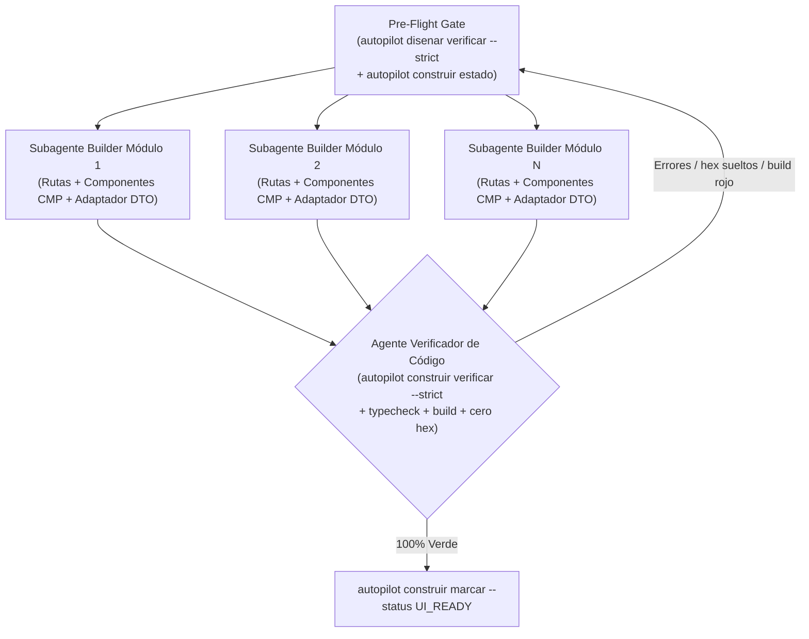

# `/screen-builder-sdd` — Constructor Multi-Agente de Pantallas Frontend-First

Herramienta #3 del **Gestor de Frontend**: cierra el ciclo **`/screen-spec-architect` → `/screen-designer-sdd` → `/screen-builder-sdd`**, transformando los documentos verificados (`00_relacional.md` + `01_frontend.md`) en **código productivo real, tipado, responsivo y accesible**, listo para funcionar primero en modo *Frontend-First* y escalar limpiamente al backend real.

> [!IMPORTANT]
> **Reglas Inquebrantables de Construcción:**
> 1. **Compuerta Pre-Flight Obligatoria:** jamás programar una pantalla sin que existan `00_relacional.md` y `01_frontend.md` aprobados (`autopilot disenar verificar --strict`).
> 2. **Cero Hex Hardcoded:** todo color, radio, fuente y sombra proviene de `docs/diseno/design-tokens.json` / `design-tokens.generated.css` (`/design-tokens-source`).
> 3. **Cero Mezcla de Librerías UI:** usar exclusivamente los componentes definidos en `toolkit.config.json → stack.ui_libraries` y trazados en `01_frontend.md` (`CMP-001..N`).
> 4. **Adaptadores Limpios Frontend-First:** nunca incrustar arreglos mock dentro de componentes visuales; aislar los stubs tipados en `adapters/<modulo>.adapter.ts` con los endpoints objetivo de `routes-map.json` para que `/mock-free-audit` pueda auditar luego el paso a `REAL_API`.
> 5. **Verificación Real Obligatoria:** ningún módulo se marca `UI_READY` sin pasar `autopilot construir verificar --strict` + `typecheck` + `build` reales del proyecto.
>
> Referencias (*progressive disclosure*):
> - `references/builder-standards-and-adapters.md` — Patrón de adaptador Frontend-First ↔ Real API, convenciones por framework y checklist del Agente Verificador de Código.
> - `scripts/screen-builder-cli.mjs` — CLI sin dependencias (`status`, `verify`, `mark` | `estado`, `verificar`, `marcar`).

---

## 1. Arquitectura Multi-Agente de Construcción



---

## 2. Procedimiento Obligatorio (5 pasos)

### Paso 1: Pre-Flight y Contexto Completo
1. Lee `toolkit.config.json`, `docs/frontend/screens-spec.json`, `docs/diseno/design-tokens.json`, `docs/arquitectura/routes-map.json` y el paquete `docs/frontend/pantallas/<slug>/00_relacional.md` + `01_frontend.md` de las pantallas objetivo.
2. Ejecuta `autopilot construir estado` para ver qué pantallas están en `SPEC` y listas para construir.

### Paso 2: Despacho de Subagentes Constructores (en paralelo por módulo)
Cuando se construyan múltiples pantallas/módulos, delega **1 subagente constructor por módulo** con rutas de archivo estrictamente disjuntas (`app/<ruta>/` + `modules/<modulo>/`), instruyendo a cada uno:
- Implementar **todos** los componentes `CMP-001..N` de `01_frontend.md` usando la librería UI exacta del proyecto (`PrimeReact`, `shadcn/ui`, `PrimeNG`, `MUI`, `Vuetify`).
- Respetar las **Decisiones Autónomas** de tipología, densidad, Base-8 y layout documentadas en `01_frontend.md`.
- Implementar obligatoriamente:
  - Los **5 estados de datos** (`Ideal`, `Loading/Skeleton`, `Empty` *first-use* vs *no-results*, `Error` con Reintentar + `traceId`, `Partial/Overflow`) en sinergia con `/system-state-screens`.
  - Los **6 estados de input**, validación `onBlur` + re-validación `onChange` tras error, `isLoading` anti-double-submit, `isDirty` Unsaved Changes Guard y `closeOnOverlayClick: false` en modales con formularios.
  - Responsive `<768px` (`/responsividad`), Vista Fija (`/mejorar-vista-fija`) y navegación teclado/WCAG 2.2 AA.
- Crear el adaptador tipado `adapters/<modulo>.adapter.ts` (`references/builder-standards-and-adapters.md`) claramente marcado `@frontend-first-stub` mientras el backend no esté conectado.

### Paso 3: Integración de Navegación y Tokens
- Conectar las nuevas rutas al sidebar (`/enterprise-sidebar`) respetando los roles RBAC de `00_relacional.md`.
- Confirmar que los estilos usan exclusivamente variables/clases de `design-tokens.json` (`autopilot tokens auditar`).

### Paso 4: Verificación Real de Código (`verificar --strict` + Build)
1. Ejecutar `autopilot construir verificar --strict` para validar:
   - Cero hex hardcoded en Tailwind (`bg-[#...]`, `text-[#...]`, `border-[#...]`).
   - Cero importaciones de librerías UI ajenas al proyecto.
   - Presencia de manejo de estados (`Loading`/`Skeleton`, `Empty`/`Error`).
2. Ejecutar `typecheck` y `build` reales del proyecto (nunca declarar éxito sin ejecutarlos).

### Paso 5: Actualizar Estado y Escalar al Backend
1. Marcar cada pantalla verificada como `UI_READY`:
   ```bash
   autopilot construir marcar --screen SCR-001 --status UI_READY --file frontend/app/login/page.tsx
   ```
2. Cuando llegue el momento de conectar el backend real, reemplazar solo el adaptador (`FRONTEND_FIRST_STUB` → `REAL_API`), correr `/mock-free-audit` y marcar `--status CONNECTED --stage REAL_API`.
3. Si el avance implica cambios grandes (`C2–C4`), registrarlo con `/change-governance` (`CHG-XXXX`).
