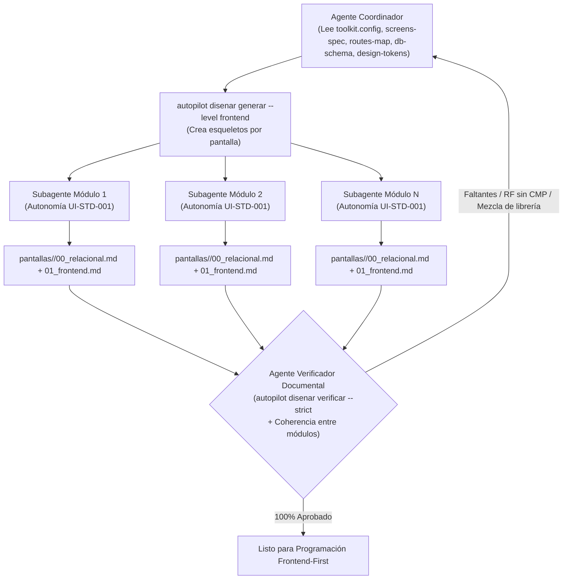

# `/screen-designer-sdd` — Orquestador Multi-Agente de Diseño de Pantallas y Componentes UI (`#frontend`, `#backend`, `#integraciones`)

Herramienta #2 del **Gestor de Frontend**: actúa como **Arquitecto Coordinador UI/UX** que despacha **subagentes diseñadores en paralelo por módulo** con **autonomía técnica justificada** para producir la documentación de ingeniería ultra-detallada de **cada pantalla** (`docs/frontend/pantallas/<slug>/`), alineada a la librería UI real del proyecto y validada al final por un **Agente Verificador Documental**.

> [!IMPORTANT]
> **Reglas Inquebrantables (`UI-STD-001` + Multi-Agente):**
> 1. **Ejecución Multi-Agente por Módulo:** cuando existan múltiples pantallas/módulos, delegar en paralelo **1 subagente diseñador por módulo** (o lote de 3–5 pantallas con carpetas disjuntas `docs/frontend/pantallas/<slug>/`) para lograr máximo nivel de detalle sin saturar un solo contexto ni generar colisiones de archivos.
> 2. **Potestad de Decisión Autónoma Justificada:** cada subagente **decide autónomamente** sin detenerse a preguntar micro-detalles: tipología exacta (entre las 16 de `UI-STD-001`), densidad (`Compacta` / `Estándar` / `Confortable`), patrón de contenedor (`Single-Page Form` vs `Wizard` >15 campos vs `Drawer` vs `Split View` vs `Detalle 360°`) y controles exactos (`Select` vs `Combobox` >15 vs `Virtualizado` >500, `Radio` 2–5 vs `Checkbox` vs `Switch`). Toda decisión queda registrada en la tabla **Decisiones Autónomas de Diseño** de `01_frontend.md`.
> 3. **Fidelidad Relacional Absoluta:** la autonomía aplica al **cómo diseñar la UI**, **NUNCA** a inventar `RF`, `CU`, roles RBAC o funcionalidades fuera de `00_relacional.md` y `plan-maestro.md`.
> 4. **Alineación estricta con la librería UI instalada:** usar exclusivamente la librería detectada en `toolkit.config.json → stack.ui_libraries` (`references/ui-library-mapping.md`: `PrimeReact`, `shadcn/ui + Radix`, `PrimeNG`, `MUI`, `Vuetify`).
> 5. **Verificación Documental Obligatoria:** el **Agente Verificador** ejecuta `autopilot disenar verificar --strict` y audita consistencia transversal antes de aprobar el pase a código.
>
> Referencias (*progressive disclosure*):
> - `references/ui-std-001-metrics-and-rules.md` — 10 principios, 8 capas, 16 tipologías, retícula Base-8, densidad, reglas estrictas de componentes, 6 estados de input, 5 estados UI, validación `onBlur`, métricas Nielsen/WCAG/UX, checklist 16.1–16.6 y puntuación 0–100.
> - `references/ui-library-mapping.md` — Equivalencia exacta hacia `PrimeReact`, `shadcn/ui + Radix`, `PrimeNG`, `MUI` y `Vuetify`.
> - `scripts/screen-designer-cli.mjs` — CLI sin dependencias (`generate`, `verify` | `generar`, `verificar`).

---

## 1. Arquitectura Multi-Agente de Generación



---

## 2. Estructura Generada por Cada Pantalla y 3 Niveles

```text
docs/frontend/pantallas/<slug-pantalla>/      # ej. login/, intranet-usuarios/
├── 00_relacional.md                          # Trazabilidad pura: SCR-XXX, Ruta, Módulo, RF, CU, Actores, RBAC, Entidades BD, Endpoints
├── 01_frontend.md                            # Nivel #frontend (UI-STD-001): Decisiones Autónomas, Tipología, Base-8, Inventario CMP-XXX en librería UI real, Fichas detalladas, 5 UI States, Checklist 16.1–16.6 y Score 0–100
├── 02_backend.md                             # Nivel #backend: Contratos API, DTOs, permisos servidor, códigos HTTP
└── 03_integraciones.md                       # Nivel #integraciones: WebSockets, R2/Storage, Turnstile, eventos, analítica
```

| Nivel / Tag | Alcance | Comando CLI |
| :--- | :--- | :--- |
| **`#frontend`** *(defecto / Frontend-First)* | Genera y diseña `00_relacional.md` + `01_frontend.md` por pantalla con subagentes en paralelo. | `autopilot disenar generar --level frontend` |
| **`#backend`** | Agrega `02_backend.md` con contratos REST/DTO, validaciones servidor y RBAC. | `autopilot disenar generar --level backend` |
| **`#integraciones`** | Agrega `03_integraciones.md` con WebSockets, storage, auth/Turnstile y eventos. | `autopilot disenar generar --level integraciones` |

---

## 3. Potestad de Decisiones Autónomas de los Subagentes

Cada subagente diseñador tiene autoridad explícita para decidir y justificar en `01_frontend.md` sin bloquear el flujo:

| Decisión Autónoma | Regla de Ingeniería (`UI-STD-001`) |
| :--- | :--- |
| **Tipología de pantalla** | Elegir entre las 16 tipologías según tarea y volumen (Auth, Dashboard Bento, Data Grid, Detalle 360°, Form único `<15` campos, Wizard `>15` campos, Drawer edición rápida, Split View revisión secuencial, Configuración, Kanban, Calendario, System States). |
| **Densidad de interfaz** | `Compacta` (`32–36px`) para operadores/tablas de alto volumen · `Estándar` (`40–48px`) para gestión general · `Confortable` (`48–56px`) para kiosco/táctil o ciudadano. |
| **Selección de controles** | `Radio` (`2–5` opciones) vs `Select` (`5–15`) vs `Combobox` (`>15`) vs `Virtualizado` (`>500`); `Switch` solo si efecto es inmediato; `Skeleton` para carga inicial vs `Spinner` en botón vs `ProgressBar` si `>5s`. |
| **Contenedor de acciones** | `Dialog` (`closeOnOverlayClick: false` en formularios) vs `Drawer` (edición sin perder tabla) vs ruta dedicada. |
| **Estrategia móvil (`<768px`)** | Reorganizar composición (no solo encoger): filtros apilados, formularios 1 columna, tablas con scroll horizontal o cards, hit-area `≥44px`, fuente input `≥16px`. |

---

## 4. Procedimiento Obligatorio del Coordinador (5 pasos)

1. **Preparación:** leer `toolkit.config.json`, `docs/frontend/screens-spec.json`, `docs/arquitectura/routes-map.json`, `docs/planeacion/plan-maestro.md`, `docs/diseno/design-tokens.json` y `docs/bd/db-schema.json`. Ejecutar `autopilot disenar generar --level frontend` para crear la estructura base.
2. **Despacho Paralelo de Subagentes por Módulo:** invocar 1 subagente por cada módulo (o lote de 3–5 pantallas) entregándole:
   - Sus rutas/pantallas exactas (`SCR-XXX`), `RF`, `CU`, roles RBAC, tablas BD y endpoints.
   - La librería UI oficial detectada (`references/ui-library-mapping.md`) y las reglas de `references/ui-std-001-metrics-and-rules.md`.
   - Instrucción explícita de ejercer **autonomía justificada** en tipología/densidad/componentes y completar al máximo detalle `00_relacional.md` y `01_frontend.md` de sus pantallas asignadas (sin tocar pantallas de otros módulos).
3. **Recolección y Revisión Transversal:** al terminar los subagentes, verificar coherencia global (misma librería UI, sin contradicciones de navegación ni duplicación de componentes).
4. **Agente Verificador Documental:** ejecutar `autopilot disenar verificar --strict` comprobando que:
   - Todas las pantallas tienen `00_relacional.md` y `01_frontend.md`.
   - El 100% de los `RF-XX` de `00_relacional.md` están trazados a componentes `CMP-XXX` en `01_frontend.md`.
   - Cada pantalla incluye su tabla de **Decisiones Autónomas de Diseño**, librería UI exacta, estados `Loading`/`Empty`/`Error`, responsive y WCAG 2.2 AA.
5. **Compuerta antes de Código:** entregar el resumen ejecutivo de pantallas diseñadas, decisiones autónomas tomadas y resultado de `verificar --strict`, esperando aprobación para pasar a la implementación Frontend-First.
